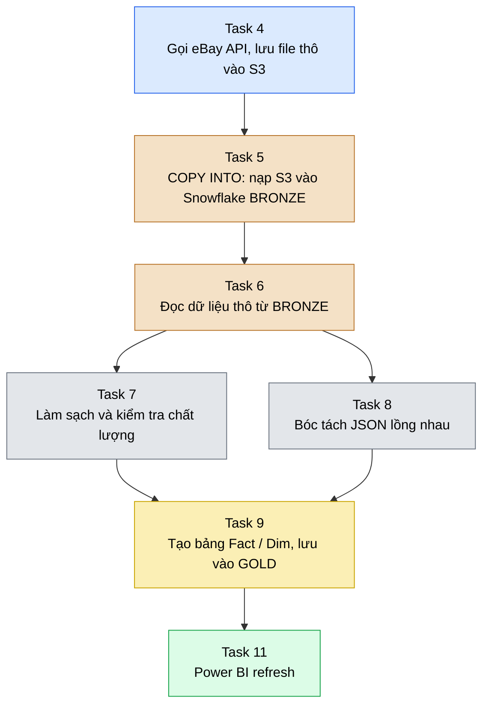
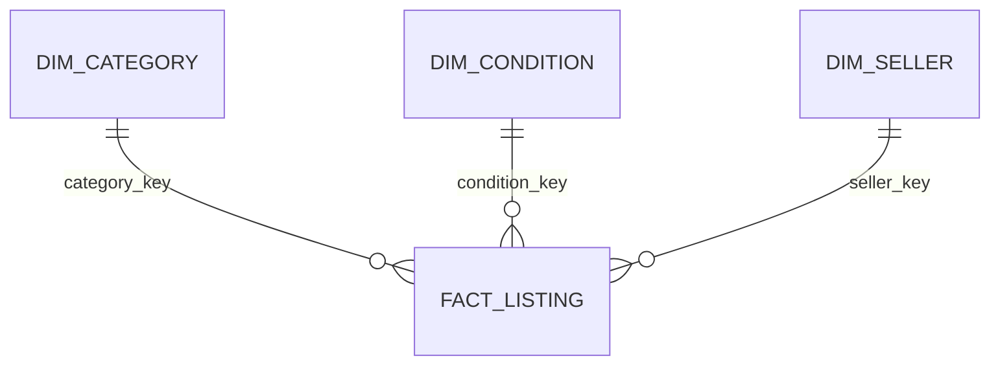

# eBay E-Commerce Intelligence & Data Pipeline

> Pipeline Data Engineering thu thập dữ liệu listing từ **eBay US API**, điều phối bằng **Airflow**, lưu trữ và biến đổi trên **Snowflake + dbt** theo **Medallion Architecture (Bronze → Silver → Gold)**, phục vụ dashboard **Power BI**.

---

## Mục lục

1. [Bài toán kinh doanh](#1-bài-toán-kinh-doanh)
2. [Kiến trúc tổng quan](#2-kiến-trúc-tổng-quan)
3. [Luồng xử lý trong DAG](#3-luồng-xử-lý-trong-dag)
4. [Mô hình dữ liệu (Gold)](#4-mô-hình-dữ-liệu-gold)
5. [Kiểm tra chất lượng dữ liệu](#5-kiểm-tra-chất-lượng-dữ-liệu)
6. [Công nghệ sử dụng](#6-công-nghệ-sử-dụng)
7. [Cấu trúc repository](#7-cấu-trúc-repository)
8. [Cài đặt và chạy](#8-cài-đặt-và-chạy)
9. [Trạng thái xác minh](#9-trạng-thái-xác-minh)


---

## 1. Bài toán kinh doanh

**Bối cảnh:** Doanh nghiệp muốn mở rộng bán hàng trên **eBay US** và cần chọn nên tập trung vào danh mục nào, định giá ra sao.

**Câu hỏi chính:**

> *"Trên eBay US, danh mục nào có mức cạnh tranh vừa phải và mặt bằng giá hấp dẫn, và nên định giá, giảm giá ở mức nào để cạnh tranh được?"*

**Hướng phân tích** (dữ liệu listing từ API):

| Nhóm | Câu hỏi | Góc nhìn |
|---|---|---|
| Giá & khuyến mãi | Mặt bằng giá mỗi danh mục? Bao nhiêu listing có giảm giá? | Median, P25, P75; tỷ lệ listing có discount |
| Vận chuyển | Free shipping có làm giá niêm yết cao hơn không? | Giá, phí ship, giá + phí ship |
| Tình trạng | New / Used / Refurbished khác nhau thế nào về giá? | Giá theo condition và category |
| Người bán | Danh mục nào có nhiều seller uy tín, mức tập trung ra sao? | Feedback score, feedback %, số listing/seller |

> **Lưu ý diễn giải:** dữ liệu là listing đang niêm yết, không phải giao dịch đã bán. Không thể suy ra doanh thu hay số lượng bán từ dữ liệu này.

---

## 2. Kiến trúc tổng quan

Dự án kết hợp **Medallion Architecture** với quy trình **ELT** (Extract → Load → Transform): dữ liệu thô được nạp vào warehouse trước, sau đó mới biến đổi bằng SQL/dbt.

```mermaid
flowchart LR
    subgraph S1["① Phát triển & triển khai"]
        direction TB
        DEV["Developer"] --> GH["GitHub"]
        GH --> CI["CI/CD<br/>kiểm tra lỗi và deploy code"]
    end

    subgraph S2["② Hạ tầng chạy 24/7 · AWS EC2"]
        direction TB
        DK["Docker containers<br/>Python · Airflow · dbt"] --> AF["Apache Airflow<br/>lên lịch · chạy DAG · retry"]
    end

    subgraph S3["③ Data pipeline · Medallion"]
        direction LR
        API["eBay API"] --> S3B[("Amazon S3<br/>Landing zone<br/>file thô")]
        S3B -- "COPY INTO" --> BR[("Snowflake<br/>BRONZE<br/>dữ liệu thô")]
        BR --> SV[("Snowflake<br/>SILVER<br/>làm sạch · kiểm tra chất lượng<br/>bóc tách JSON")]
        SV --> GD[("Snowflake<br/>GOLD<br/>fact_listing + dimensions")]
    end

    PBI["④ Power BI<br/>Dashboard"]

    CI -- "deploy code" --> DK
    AF -. "điều phối các task" .-> S3
    GD --> PBI

    classDef bronze fill:#f4e1c6,stroke:#b8742a,color:#000
    classDef silver fill:#e3e6ea,stroke:#6b7480,color:#000
    classDef gold fill:#fbefb5,stroke:#c9a400,color:#000
    class BR bronze
    class SV silver
    class GD gold
```



**Cách đọc sơ đồ:**

| Khối | Vai trò |
|---|---|
| ① Phát triển & triển khai | Dev đẩy code lên GitHub; CI/CD kiểm tra và đưa code mới lên máy chủ EC2. |
| ② Hạ tầng 24/7 | EC2 luôn chạy; Docker đóng gói môi trường; Airflow bên trong Docker là "nhạc trưởng" kích hoạt pipeline theo lịch. |
| ③ Data pipeline | Dữ liệu đi một chiều: API → S3 → Bronze → Silver → Gold. |
| ④ Power BI | Kết nối tầng Gold để dựng dashboard. |

**Vai trò từng tầng Medallion:**

| Tầng | Nội dung | Thành phần |
|---|---|---|
| **Bronze** | Dữ liệu thô nạp từ S3 bằng `COPY INTO`, chưa chỉnh sửa, dùng để truy vết và xử lý lại | Schema Bronze trên Snowflake |
| **Silver** | Chuẩn hóa kiểu dữ liệu, làm sạch, kiểm tra chất lượng, bóc tách JSON lồng nhau | Schema `SILVER` (dbt: staging, data_quality, intermediate) |
| **Gold** | Mô hình hình sao (Star Schema): 1 bảng fact + các bảng dimension | Schema `GOLD` (dbt: marts) |

---

## 3. Luồng xử lý trong DAG

Airflow kích hoạt các task theo thứ tự phụ thuộc dưới đây (số task giữ theo thiết kế của dự án).



| Task | Việc làm | Tầng |
|---|---|---|
| 4 | Script Python gọi eBay API, ghi dữ liệu thô vào S3 (landing zone) | Ingestion |
| 5 | Snowflake `COPY INTO` nạp file từ S3 vào bảng Bronze | Bronze |
| 6 | Đọc dữ liệu từ Bronze để chuẩn bị biến đổi | Bronze → Silver |
| 7 | Làm sạch, chuẩn hóa kiểu dữ liệu, chạy kiểm tra chất lượng | Silver |
| 8 | Mở rộng (flatten) các trường JSON lồng nhau thành cột dạng bảng | Silver |
| 9 | Tạo các bảng fact và dimension theo Star Schema | Gold |
| 11 | Power BI làm mới dữ liệu từ Gold | BI |

**Ánh xạ sang model dbt** (đã chạy thành công, xem log ở [mục 5](#5-kiểm-tra-chất-lượng-dữ-liệu)):

| Task | Model dbt | Schema | Materialization |
|---|---|---|---|
| 6 | `stg_ebay_raw` | `SILVER` | view |
| 7 | `ebay_data_cleaned`, `dq_check` | `SILVER` | incremental |
| 8 | `ebay_data_json_expanded` | `SILVER` | table |
| 9 | `fact_listing`, `dim_category`, `dim_condition`, `dim_seller`, `dim_date` | `GOLD` | table |

> Thứ tự task chính xác được định nghĩa trong `dags/dag_ebay_ingest_pipeline.py`, đó là nguồn tham chiếu cuối cùng nếu có khác biệt với sơ đồ trên.

---

## 4. Mô hình dữ liệu (Gold)

Mô hình hình sao gồm 1 bảng fact và 4 bảng dimension:



| Model | Khóa đã được kiểm tra | Vai trò |
|---|---|---|
| `fact_listing` | `listing_key` (not_null, unique); `category_key`, `seller_key`, `condition_key` (relationships tới dimension) | Bảng dữ kiện, mỗi dòng là một listing theo grain định nghĩa trong SQL |
| `dim_category` | `category_key` (not_null, unique) | So sánh giá và listing theo danh mục |
| `dim_condition` | `condition_key` (not_null, unique) | So sánh theo tình trạng sản phẩm |
| `dim_seller` | `seller_key` (not_null, unique) | Phân tích theo người bán |
| `dim_date` | Chưa có test trong log | Phân tích theo thời gian |

> Sơ đồ chỉ vẽ các quan hệ đã có test `relationships` trong log `dbt build`. `dim_date` có trong mô hình nhưng chưa có test khóa hay quan hệ với fact, nên không vẽ vào sơ đồ.

---

## 5. Kiểm tra chất lượng dữ liệu

Kết quả chạy trên target `dev` (log `dbt build` của dự án).

### 5.1. Tầng Silver: `dbt build --select +dq_check`

**13 mục: 10 thành công, 3 cảnh báo (warn), 0 lỗi.**

| Kết quả | Test | Ý nghĩa |
|---|---|---|
| ✅ Passed | `not_null` · `item_id` | Mọi listing đều có ID |
| ✅ Passed | `unique` · `item_id` | Không trùng ID |
| ✅ Passed | `not_null` · `legacy_item_id` | Có legacy ID |
| ✅ Passed | `not_null` · `price_value` | Giá không bị thiếu |
| ✅ Passed | `expression_is_true` · `price_value` | Điều kiện so với 0 (xem `schema.yml`) |
| ✅ Passed | `expression_is_true` · `current_bid_price_value` | Điều kiện so với 0 (xem `schema.yml`) |
| ✅ Passed | `expression_is_true` · `bid_count` | Điều kiện so với 0 (xem `schema.yml`) |
| ✅ Passed | `expression_is_true` · `seller_feedback_percentage` | Nằm trong khoảng 0 – 100 |
| ⚠️ Warn | `expression_is_true` · `marketing_price_discount_percentage` | Kỳ vọng nằm trong khoảng 0 – 100 |
| ⚠️ Warn | `accepted_values` · `adult_only` | Kỳ vọng thuộc `True`, `TRUE`, `FALSE` |
| ⚠️ Warn | `expression_is_true` · `seller_feedback_score` | Điều kiện so với 0 (xem `schema.yml`) |

Cả 3 cảnh báo nằm trong `models/staging/schema.yml` (dòng 54, 90, 72). Cảnh báo không làm dừng pipeline nhưng cần điều tra dữ liệu nguồn trước khi dùng các cột này để ra kết luận.

Các model Silver còn lại đã chạy thành công:

| Lệnh | Model | Kết quả |
|---|---|---|
| `dbt run --select ebay_data_cleaned` | `SILVER.ebay_data_cleaned` (incremental) | ✅ 1/1 |
| `dbt run --select ebay_data_json_expanded` | `SILVER.ebay_data_json_expanded` (table) | ✅ 1/1 |

### 5.2. Tầng Gold: `dbt build --select marts`

**16 mục: 16 thành công** (5 model + 11 test).

| Nhóm test | Kết quả |
|---|---|
| `not_null` + `unique` trên `category_key`, `condition_key`, `seller_key`, `listing_key` | ✅ Passed |
| `relationships` `fact_listing` → `dim_category`, `dim_seller`, `dim_condition` | ✅ Passed |

### 5.3. Nguyên tắc dữ liệu

- Không tự động thay `NULL` bằng 0: thiếu dữ liệu khác với giá trị bằng 0.
- Chỉ so sánh giá giữa các listing sau khi xác nhận cùng đơn vị tiền tệ.
- Khi bóc tách JSON lồng nhau phải đảm bảo không nhân bản listing (đã có test `unique` trên `item_id` ở staging và `listing_key` ở fact).

---

## 6. Công nghệ sử dụng

| Hạng mục | Công cụ |
|---|---|
| Nguồn dữ liệu | eBay API |
| Ngôn ngữ | Python, SQL |
| Điều phối | Apache Airflow (Astronomer) |
| Container | Docker, Docker Compose |
| Hạ tầng | AWS EC2 (chạy 24/7) |
| Data lake / landing zone | Amazon S3 |
| Data warehouse | Snowflake (Bronze / Silver / Gold) |
| Biến đổi dữ liệu | dbt (kèm `dbt_utils`) |
| Kiến trúc | Medallion Architecture, ELT, Star Schema |
| BI | Power BI |
| Quản lý mã nguồn & CI/CD | Git, GitHub (thư mục `.github`) |

---

## 7. Cấu trúc repository

```text
ddd/
├── .astro/                         # Cấu hình Astronomer
├── .github/                        # Workflow CI/CD
├── dags/
│   └── dag_ebay_ingest_pipeline.py # Định nghĩa DAG
├── include/
│   └── ebay_ingest.py              # Script Python cào dữ liệu từ Ebay API
├── jaffle_shop/                    # dbt project
│   ├── models/
│   │   ├── staging/                # stg_ebay_raw, ebay_data_cleaned, schema.yml
│   │   ├── data_quality/           # dq_check
│   │   ├── intermediate/           # ebay_data_json_expanded
│   │   └── marts/                  # fact_listing, dim_*, marts.yml
│   ├── seeds/
│   ├── dbt_project.yml
│   ├── packages.yml
│   └── profiles.yml
├── plugins/
├── tests
├── .env                            
├── airflow_settings.yaml
├── docker-compose.yml
├── Dockerfile
├── packages.txt
├── requirements.txt
└── README.md
```

| Thư mục | Vai trò |
|---|---|
| `dags/` | DAG và quan hệ phụ thuộc giữa các task |
| `include/` | Mã Python cho bước ingestion |
| `jaffle_shop/` | Toàn bộ dbt project (tên `jaffle_shop` là tên mặc định của dbt) |
| `models/staging/` | Chuẩn hóa dữ liệu thô và schema tests |
| `models/data_quality/` | `dq_check`, kiểm tra chất lượng |
| `models/intermediate/` | Bóc tách JSON lồng nhau |
| `models/marts/` | Fact và dimension cho BI |
| `macros/generate_schema_name.sql` | Quyết định tên schema thực tế (`SILVER`, `GOLD`) |

> Không commit `.env`, `target/`, `logs/`, `dbt_packages/`, `__pycache__/`. Hãy kiểm tra các mục này đã nằm trong `.gitignore`.

---

## 8. Cài đặt và chạy

### Yêu cầu

- Git, Docker Desktop (hoặc Docker Compose), Astro CLI
- Tài khoản eBay Developer (để gọi API)
- Tài khoản Snowflake
- (Triển khai cloud) AWS: EC2, S3

### 8.1. Clone

```bash
git clone <REPOSITORY_URL>
cd ddd
```

### 8.2. Cấu hình môi trường

Tạo file `.env` ở thư mục gốc với các biến mà `docker-compose.yml`, DAG và `include/ebay_ingest.py` đọc (eBay API, Snowflake, AWS). Đối chiếu tên biến trong mã nguồn; **không commit** token hay mật khẩu.

Cấu hình kết nối Snowflake cho dbt trong `jaffle_shop/profiles.yml` (target `dev`).

### 8.3. Khởi động Airflow

```bash
astro dev start
```

Mở Airflow UI tại URL terminal thông báo (thường là `http://localhost:8080`), bật DAG `dag_ebay_ingest_pipeline`.

### 8.4. Chạy dbt

```bash
cd jaffle_shop
dbt deps

# Silver: staging + kiểm tra chất lượng
dbt build --select +dq_check
dbt run   --select ebay_data_cleaned
dbt run   --select ebay_data_json_expanded

# Gold: fact + dimension + tests
dbt build --select marts
```

---

## 9. Trạng thái xác minh

Phân biệt phần đã có bằng chứng chạy thực tế với phần mô tả kiến trúc:

| Thành phần | Trạng thái | Bằng chứng |
|---|---|---|
| dbt Silver (staging, dq_check, cleaned, json_expanded) | ✅ Đã chạy | Log `dbt build` / `dbt run` trên target `dev` |
| dbt Gold (fact + 4 dim) và tests | ✅ Đã chạy | Log `dbt build --select marts`: 16/16 thành công |
| DAG Airflow, script ingestion | 📁 Có trong repo | `dags/dag_ebay_ingest_pipeline.py`, `include/ebay_ingest.py` |
| Docker / Astronomer | 📁 Có trong repo | `Dockerfile`, `docker-compose.yml`, `.astro/` |
| CI/CD | 📁 Có thư mục | `.github/` (nội dung workflow cần đối chiếu) |
| EC2, S3, `COPY INTO` Bronze, Power BI refresh | 📝 Theo thiết kế kiến trúc | Cần bổ sung log/ảnh chụp cấu hình khi hoàn thiện tài liệu |

---
